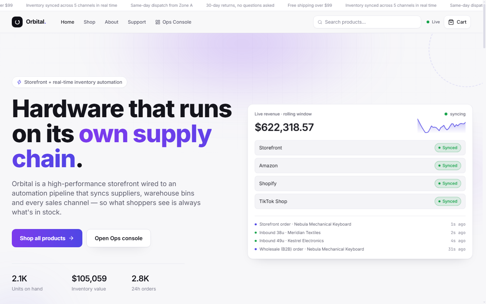
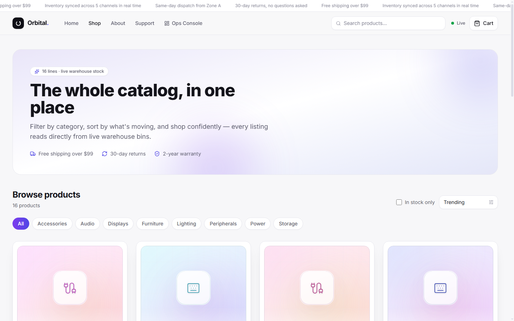
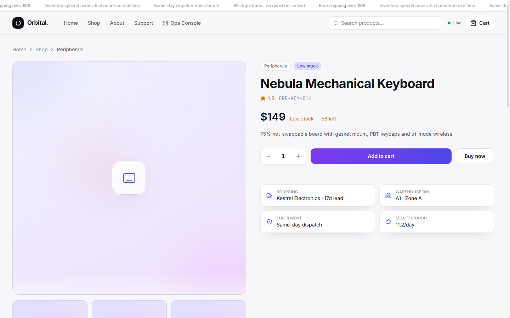
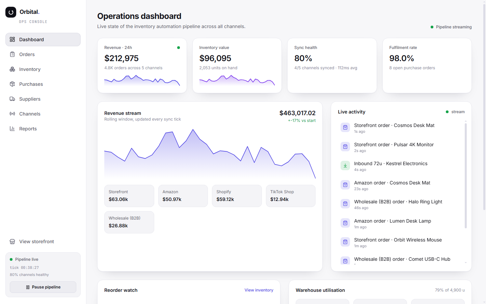

<div align="center">

# Orbital Retail — Storefront & Ops

A high-performance storefront wired to a real-time inventory automation pipeline.

[](https://react.dev/)
[](https://vite.dev/)
[](https://tailwindcss.com/)
[](LICENSE)
[](https://github.com/Faizan-khan144/orbital-retail/graphs/contributors)
[](https://github.com/Faizan-khan144/orbital-retail/commits/main)

</div>

> **Hardware that runs on its own supply chain.** Shoppers browse a live catalog that reads directly from warehouse bins, while operators watch orders, stock, suppliers and sales channels sync in the ops console — all streaming in real time.

---

## Screenshots

| Storefront | Product catalog |
| --- | --- |
|  |  |

| Product detail | Ops dashboard |
| --- | --- |
|  |  |

---

## Features

- **Live inventory engine** — a rolling simulation streams sales, shipments, bin transfers and channel syncs into the UI every ~2 seconds.
- **Warehouse-aware catalog** — product pages read live bin stock, so sold-out items can never oversell.
- **Quick-view modal** — click any product tile to inspect details and add to cart without leaving the grid.
- **Persistent cart** — the cart survives page refreshes via `localStorage`.
- **Ops console** — dashboard, orders, inventory, purchases, suppliers, channels and reports.
- **Motion layer** — reveal-on-scroll, stagger, float, drift, sheen, gradient text and hover-lift built on a token-based theme.

## Tech stack

| Layer | Choice |
| --- | --- |
| Build | Vite 8 |
| UI | React 19 |
| Routing | react-router-dom 7 |
| Styling | Tailwind CSS v4 (via `@tailwindcss/vite`) |
| Icons | lucide-react |
| Lint | oxlint |

## Getting started

```bash
git clone https://github.com/Faizan-khan144/orbital-retail.git
cd orbital-retail
npm install
npm run dev
```

The dev server runs at `http://localhost:5173`.

### Scripts

```bash
npm run dev       # start the dev server
npm run build     # production build to dist/
npm run preview   # preview the production build
npm run lint      # run oxlint
```

## Routes

**Storefront**

| Route | Page |
| --- | --- |
| `/` | Home with live revenue hero, categories, how-it-works, testimonials, FAQ and newsletter |
| `/shop` | Catalog with category filters, sorting and search |
| `/product/:id` | Product detail, specifications, shipping and reviews |
| `/checkout` | Cart review and order placement |
| `/about`, `/support` | Brand story and help center |

**Ops console**

| Route | Page |
| --- | --- |
| `/ops` | Real-time dashboard with KPIs and live event feed |
| `/ops/orders` | Order queue with allocation and fulfilment status |
| `/ops/inventory` | Live stock levels and warehouse bins |
| `/ops/purchases` | Purchase orders and inbound shipments |
| `/ops/suppliers` | Supplier directory and lead times |
| `/ops/channels` | Sales channel sync health |
| `/ops/reports` | Performance and sell-through analytics |

## Project structure

```
src/
  components/     # shared UI (layouts, product tile/card, cart drawer, quick view)
  data/           # seed data: products, suppliers, bins, channels
  lib/            # store engine, formatting helpers, icon maps
  pages/
    store/        # customer-facing pages
    ops/          # operations console pages
  App.jsx         # route table
  index.css       # theme tokens + animation layer
docs/
  screenshots/    # rendered screenshots used in this README
```

## License

MIT — see [LICENSE](LICENSE).

---

<div align="center">
Made by <a href="https://github.com/Faizan-khan144">Muhammad Faizan Khan</a>
</div>
